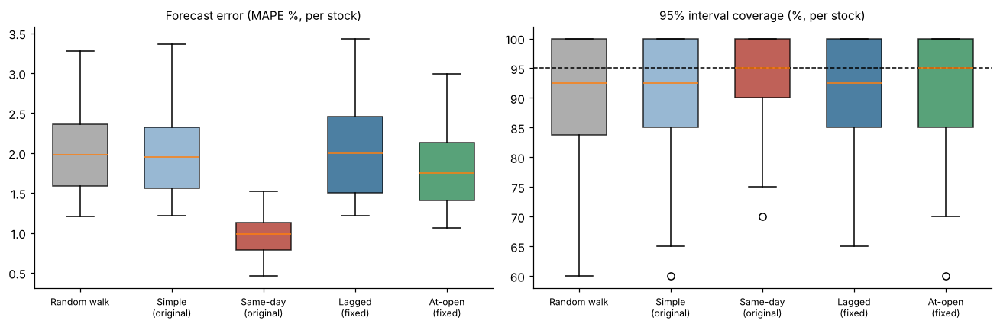
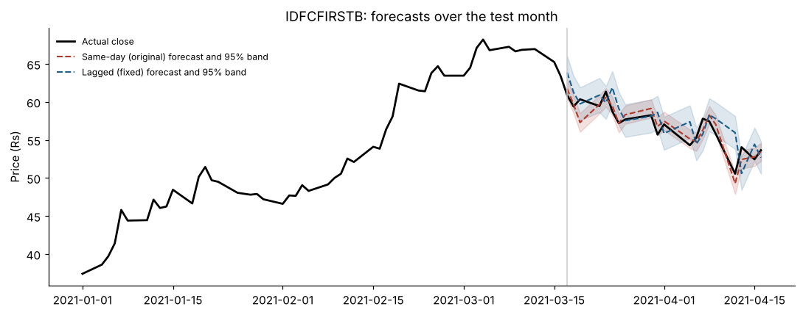

# Predicting NSE Closing Prices with Regression, and a Look-Ahead Bias Check
**30 NSE stocks · per-stock OLS with 95% prediction intervals · random-walk benchmark · placebo test**

This project rebuilds my 2021 term project at IIT Kharagpur (supervisor: Dr. Debjani Chakraborty). The original found that a multiple regression on *previous close, day low and number of trades* predicted closing prices within a 95% band for 29/30 stocks, against 14/30 for a simple regression on previous close.

The rebuild asks a model-validation question: **the day's low and number of trades are only known after the close, so is that model really forecasting?**

## Key findings
**The original model's advantage was look-ahead bias.** Using the same day's low, the multiple regression halves the error of a random walk. A placebo test on simulated stocks, where nothing is predictable, gives the same "win," which proves the edge comes from information a forecaster wouldn't have yet. With yesterday's values instead, the advantage disappears. The opening price, which is known at 9:15 am, gives a small but legitimate gain.

**28 NSE stocks, test period 17 Mar – 18 Apr 2021 (20 trading days each)**

| Model | Uses future info? | Median MAPE | Beats random walk | Significantly (DM, 5%) |
|---|---|---|---|---|
| Random walk (benchmark) | No | 1.98% | — | — |
| Simple: previous close | No | 1.96% | 19 / 28 | 3 |
| **Same-day (original)**: + day's low, trades | **Yes** ⚠️ | 0.98% | 28 / 28 | 14 |
| Lagged (fixed): + *yesterday's* low, trades | No | 2.00% | 13 / 28 | 0 |
| **At-open (fixed)**: + today's open | No | **1.75%** | **26 / 28** | 4 |
| *Placebo: same-day model on unpredictable fake stocks* | *Yes* | *0.89% vs 1.64%* | *30 / 30* | *25* |



**Other findings**
- **Multicollinearity:** the six price variables have median VIFs between about 280 and 2,800. That's why the original project dropped most of them. Even previous close and day low together still have VIFs around 80.
- **The simple regression is a random walk:** its median slope is 0.994.
- **Misses are stock-specific:** JSW Steel, IDFC First Bank and Tata Steel had the lowest interval coverage. IDFC First Bank's weak result matches the original report's explanation, the March 2021 QIP share sale.

<details>
<summary>Example: IDFC First Bank over the test month</summary>


</details>

**Data notes.** 29 of the 30 original stocks downloaded. Jet Airways traded only in the restricted BZ segment while suspended, so it has no regular data. Mrs Bectors Food listed in Dec 2020, so it has only 56 training days and was excluded (the minimum is 60). Full per-stock results are in `results/per_stock_scores.csv`.

## What's inside
| Step | Details |
|---|---|
| **Data** | NSE *Security-wise Price volume & Deliverable position* report, Mar 2020 – Apr 2021: prices, volume, turnover, number of trades, deliverable quantity |
| **Variable selection** | Variance inflation factors for the 11 candidate variables, explaining why most were dropped |
| **Models** (one per stock) | Simple: `close ~ prev_close` · Same-day (original): `+ low_t + trades_t` · Lagged (fixed): `+ low_(t-1) + trades_(t-1)` · At-open (fixed): `+ open_t` · Random walk |
| **Evaluation** | Train 17 Mar 2020 – 16 Mar 2021, test 17 Mar – 18 Apr 2021. MAPE, 95% interval coverage, Diebold–Mariano test vs random walk |
| **Placebo test** | The same models run on simulated random-walk stocks where nothing is predictable. A model that still "wins" there is using future information |

## Project structure
```
nse-equity-regression/
├── data/raw/                       # NSE download (nse_prices.csv)
├── notebooks/
│   └── nse_equity_regression.ipynb # the full analysis, start here
├── results/                        # summary tables and figures
├── src/
│   ├── download_data.py            # fetches the 30 stocks from NSE (nselib)
│   ├── data.py                     # cleaning, lagged features, train/test split
│   └── models.py                   # VIF, OLS models, random walk, scoring, placebo
└── requirements.txt
```

## How to run
```bash
git clone https://github.com/Nikhil-Bhunwal/nse-equity-regression.git
cd nse-equity-regression
pip install -r requirements.txt
python src/download_data.py
jupyter notebook notebooks/nse_equity_regression.ipynb
```

## Author
**Nikhil Bhunwal** · M.Sc. Mathematics & Computing, IIT Kharagpur · [LinkedIn](https://linkedin.com/in/nikhil-bhunwal-2963a0165) · [GitHub](https://github.com/Nikhil-Bhunwal)
